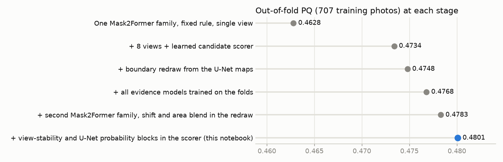

# kaggle_filament_2026
Code for final submission - LB 0.41

## Solar filament instance segmentation

Solar filaments are dark, elongated clouds of cool plasma seen against the Sun's disk in H-alpha. The task
([filament-segmentation-2026](https://www.kaggle.com/competitions/filament-segmentation-2026)) is to outline every filament in 2048 x 2048
full-disk images as its own mask. Entries are scored by panoptic quality (PQ) against each annotator's drawing separately: a predicted mask
counts only if it overlaps that annotator's filament by more than half (IoU > 0.5).

**Final submission: out-of-fold PQ 0.4770 on the 707 training photos** (Kaggle submission ref 58304440).



## Approach

```
 photos ──► Mask2Former, grayscale input (5 folds) ─────────► 8 views ──┐
        ──► Mask2Former, limb-corrected input (5 folds) ────► 8 views ──┴─► one fused 16-view candidate pool per photo
        ──► Mask R-CNN + 3 U-Nets (5 folds) ──► detector candidates, probability + spine maps ──┐
        ──► ROI detector + refiner (5 folds) ──► ROI candidates ────────────────────────────────┤
                                                                                                  ▼
   76 numbers per candidate ──► LightGBM scorer q (expected matched IoU) ──► exact non-overlapping selection
   ──► 5 fold models fused on test ──► boundaries redrawn within 3 px from the U-Net maps ──► submission.csv
```

1. **Candidates.** Two Swin-S Mask2Former families, trained at native resolution on the 5 folds of `data/folds.json` (grouped by date).
   One reads the grayscale photo; the other reads the photo, its limb-darkening-corrected disk and a CLAHE copy. Each fold model predicts
   8 rotated / mirrored views, and the 16 views of a fold's two models are fused into one candidate pool.
2. **Evidence.** Independent models trained on the same folds check each candidate: a Mask R-CNN, three U-Nets (filament probability and
   centre-line maps), and a tiled ROI detector with a mask refiner.
3. **Learned scorer.** LightGBM predicts, for each candidate, its expected IoU with the annotators' filaments. It uses 76 numbers: shape,
   scores, image contrast, competing candidates and agreement with every evidence model. It is cross-fitted: every training photo is scored
   by a model that never saw its fold, on candidates from models that never saw it.
4. **Selection.** Among a photo's candidates, the set maximising the sum of (q - tau) with no two masks overlapping by more than 10 % of
   the smaller one, solved exactly (integer programming). On test, the 5 fold models' candidates are fused first.
5. **Full-resolution boundaries.** Mask2Former masks come out at 1/4 resolution. Each kept mask keeps its extent, and its boundary is redrawn
   within 3 px from the full-resolution U-Net probability maps.

The models, epochs, scorer settings and selection threshold are chosen on out-of-fold PQ. For the boundary redraw, 1 px and 3 px are
equivalent out of fold (0.4774 vs 0.4770, difference -0.0003, 95% interval -0.0012 to +0.0006); the final uses 3 px.


## Reproducing the result

`PIPELINE.ipynb` runs the whole pipeline, from the photos to `outputs/submission.csv`, with every step explained. It rebuilds the submitted
file **byte for byte**; its last check compares SHA-256 hashes.

* **Integrity.** The data, the 40 checkpoints and the shipped inference outputs are checked against `reference/CHECKSUMS.json`. A missing or
  changed model is listed with its training time, and retrained only after you confirm.
* **Training.** The training code was checked against the original runs: same losses at the first steps (to the digit for the ROI models,
  within GPU rounding noise for Mask2Former).
* **Time.** With the downloaded models, a run takes about 45 min on 4 x 12 GB GPUs (U-Net maps, then ~15 min of CPU for the scorer and
  redraw). Retraining all 40 models takes about 115 GPU-hours, about 28 h on 4 x 12 GB GPUs (details below).

### Hardware used

The models were trained, and the submission produced, on one rented cloud GPU server:

| | |
|---|---|
| GPUs | 4 x NVIDIA GeForce RTX 3080 Ti, 12 GB each (PCIe 4.0 x16), driver 595.99 |
| CPU | 2 x AMD EPYC 7543 (32 cores each); the container was limited to about 27 cores |
| Memory | 377 GB RAM, including a 41 GB RAM disk (`/dev/shm`) for the large intermediate files |
| Disk | 32 GB |
| Software | Ubuntu 24.04, Python 3.12.3, PyTorch 2.8.0 with CUDA 12.8 |

### Training time, and why it is long

Retraining all 40 models takes about 115 GPU-hours, about 28 h on this server. Inference adds about 1.5 h.

| Models | Runs | Time per run | GPU-hours | Wall time on the 4 GPUs |
|---|---|---|---|---|
| Mask2Former, 2 families x 5 folds | 10 | ~5.5 h | ~55 | ~16.5 h (one run per GPU, 3 rounds) |
| Mask R-CNN + 3 U-Nets, 5 folds | 20 | 1.2-2.7 h | ~35 | ~4.5 h (two runs per GPU) |
| ROI detector + refiner, 5 folds | 10 | 2-3 h | ~25 | ~5 h (up to 4 runs per GPU) |

* **Every model is trained 5 times**, once per fold. The scorer learns from out-of-fold predictions, so every training photo must be
  predicted by models that never saw it.
* **Mask2Former trains at native resolution**: 1024-pixel crops and whole 2048-pixel frames, 50 epochs of 231 optimiser steps (batch 8).
  On a 12 GB GPU the batch of 8 is accumulated one image at a time, and the backbone is recomputed in the backward pass (gradient
  checkpointing), so a step takes about 1.6 s. The held-out evaluations every 5 epochs add the rest.
* **12 GB limits sharing**: only one Mask2Former training fits on a GPU. A GPU with 40-80 GB of memory would avoid the accumulation and
  the recomputation, so it should be faster per step (not measured here).
* **A cheaper variant**: in the report's ablations, the ROI detector + refiner and the second Mask2Former family each add nothing
  measurable out of fold. Without them, retraining would take about 62 GPU-hours (about 15 h on 4 GPUs). Removing both at once was not
  measured.

### Setup

```bash
git clone git@github.com:Emualliug2705/kaggle_filament_2026.git && cd kaggle_filament_2026
python3.12 -m venv venv && . venv/bin/activate
pip install --extra-index-url https://download.pytorch.org/whl/cu128 \
    -r env/requirements-venv.txt -r env/requirements-extra.txt jupyterlab
jupyter lab PIPELINE.ipynb          # run all cells; or headless: python run_headless.py
```

* **Kaggle.** Put your API token in `~/.kaggle/kaggle.json` and accept the competition rules. The photos and annotations are downloaded into
  `data/`.
* **Models.** `filament_models.tar` (7.4 GB: the trained models and the inference outputs) is downloaded from Google Drive (the link is in
  `reference/DOWNLOADS.json`). You can also place it in `downloads/`. Its SHA-256 is checked before extraction.
* **Hardware.** Linux, NVIDIA GPUs with 12 GB or more, a driver supporting CUDA 12.8, and ~35 GB free for `work/scratch`. Keep the
  repository on a normal disk, not a `noexec` RAM disk. To move a folder, set `FILAMENT_DATA`, `FILAMENT_MODELS`, `FILAMENT_WORK`,
  `FILAMENT_SCRATCH`, `FILAMENT_OUTPUTS` or `FILAMENT_DOWNLOADS`.

## v2: supervising the trainings with WeightsLab

This branch (`v2-weightslab`) adds [WeightsLab](https://github.com/GrayboxTech/weightslab) to every training: each run serves
its own web UI while it trains, and after training one command opens a single UI over all runs. **Training itself is
unchanged**. WeightsLab never wraps the models, optimisers, losses or data loaders. It receives copies of the numbers the
trainers already compute, and its start-up and the added held-out passes run with the random generators saved and
restored. Checked with short runs of every model (fold 0) with WeightsLab on and off:
* **U-Nets (cnx, cnxL, r34) and ROI refiner:** bit-identical weights.
* **Mask2Former, Mask R-CNN and ROI detector:** these use GPU kernels whose backward pass is not deterministic
  (deformable attention, RoIAlign). Two runs *without* WeightsLab differ from each other in the same tensors and by the
  same amount as a run with it and one without (largest weight difference 7e-5, 6e-3 and 2e-4). Their first-step
  losses are identical: 52.7831 (`mask2former`), 50.8787 (`mask2former_limb`) and 1.1265 (ROI detector), as in the
  original trainings.

```bash
pip install -r env/requirements-weightslab.txt      # after the Setup install; WeightsLab 2.0.3 needs pandas < 3, Pillow < 12
```

**During training.** Launch the trainings as before (`src.training.mask2former`, `src.training.evidence_models train`,
`src.training.train_roi`, or the notebook with `RETRAIN=1`). Each (model, fold) run prints
`WEIGHTSLAB {model}-f{fold}: UI http://localhost:PORT` and writes the address to `models/{model}-f{fold}/weightslab.json`.
The ports are fixed, so parallel runs never collide (a busy port falls back to a free one, and the printed address is the
one used):

| model | fold 0 | fold 1 | fold 2 | fold 3 | fold 4 | full data |
|---|---|---|---|---|---|---|
| `mask2former` | 8100 | 8101 | 8102 | 8103 | 8104 | 8105 |
| `mask2former_limb` | 8106 | 8107 | 8108 | 8109 | 8110 | 8111 |
| `maskrcnn` | 8112 | 8113 | 8114 | 8115 | 8116 | 8117 |
| `unet_cnx` | 8118 | 8119 | 8120 | 8121 | 8122 | 8123 |
| `unet_cnxL` | 8124 | 8125 | 8126 | 8127 | 8128 | 8129 |
| `unet_r34` | 8130 | 8131 | 8132 | 8133 | 8134 | 8135 |
| `roi_detector` | 8136 | 8137 | 8138 | 8139 | 8140 | 8141 |
| `roi_refiner` | 8142 | 8143 | 8144 | 8145 | 8146 | 8147 |

`python -m src.training.weightslab_global --list` shows every run, whether it is still training, and its address. On a
remote GPU machine, forward the ports: `ssh -N -L 8100:localhost:8100 -L 8118:localhost:8118 ... user@host`.

What each run's UI shows (experiment `{model}-f{fold}`, folder `models/{model}-f{fold}/`):
* **Data**: the 707 training photos. They are split as `fold{k}_train` and `fold{k}_val` and tagged `fold{k}` = train | val.
  Each photo shows with an overlay counting the annotators who drew a filament on each pixel (0-3), plus its site,
  date, annotator count and user fold.
* **Curves** `train/*`: the step loss and its terms, learning rate. `val/*`: held-out results. Mask2Former reports its
  evaluation every 5 epochs: pooled PQ of the best emission rule, plus SQ, RQ and the threshold. The U-Nets, Mask R-CNN
  and ROI models get a held-out loss pass every `FILAMENT_WL_EVAL_EVERY` steps (default 2000 U-Net, 1500 Mask R-CNN and
  detector, 3000 refiner) on fixed crops of the held-out photos. That pass leaves the weights, BatchNorm statistics and
  random generators untouched.
* **Per-photo signals** `train/photo_*` (each crop's own loss, on its photo; Mask R-CNN gives only the batch loss) and
  `val/photo_*` (Mask2Former: PQ, TP, FP, FN of each held-out photo; the others: held-out loss and its terms).
* The pause button holds training between two steps. Hyperparameter inputs are read-only: the trainers do not read them
  back.

**After training: one UI over everything.**

```bash
python -m src.training.weightslab_global            # http://localhost:8099, Ctrl+C to stop
```

It reads every run under `models/` (never modifies them; a run still training is read from a copy) and rebuilds
`models/_weightslab_global/`:
* **All curves**, one per run.
* **The 707 photos once**, with tags `fold0` … `fold4` = train | val.
* **Per-model per-photo columns**, folds pooled:
  * `{model}/oof_{signal}`: the held-out value, from the one run that did not train on the photo, e.g. `mask2former/oof_pq`.
  * `{model}/train_{signal}`: the training loss, averaged over the four runs that trained on it (last 10 % of steps).
* Every run's per-photo trajectories.

A photo has the same WeightsLab id in every run and in the global view (a hash of its cached thumbnail,
`work/weightslab/photos_256.npz`).

Settings (environment): `FILAMENT_WEIGHTSLAB=0` turns it off (it is also off when the package is not installed);
`FILAMENT_WL_UI_PORT` / `FILAMENT_WL_GRPC_PORT` move the port ranges (8100 / 50100); `FILAMENT_WL_HOST` (0.0.0.0);
`FILAMENT_WL_LINGER=3600` keeps a finished run's UI up for an hour; `FILAMENT_WL_KERNEL=1` embeds WeightsLab's Jupyter
kernel (off by default: it takes over Ctrl+C). WeightsLab's own variables (`WL_NO_TELEMETRY=1`, ...) apply as usual.
Each run's folder grows by about 10 MB (WeightsLab's database, per-photo table and log).

## Layout

```
src/
  paths.py          every folder the pipeline uses (environment overrides)
  data/             folds and splits, photo utilities
  models/           mask2former/ (model, data, training loop, evaluation), maskrcnn.py, unet.py, roi/ (detector + refiner)
  training/         launchers and trainers: mask2former.py, evidence_models.py, train_unet.py, train_maskrcnn.py, train_roi.py;
                    weightslab_global.py (one WeightsLab UI over every run)
  inference/        Mask2Former caches and views, two-family pools, ROI banks, view fusion
  scorer/           features + LightGBM + selection (selector.py), exact selection (select.py), boundary redraw
  evaluation/       out-of-fold matching and PQ, validation sweeps
  utils/            masks, events, weightslab_monitor.py (each training's WeightsLab session)
configs/            model and data settings
data/folds.json     the 5 folds (photos and annotations are downloaded)
reference/          checksums, download sources, the submitted file's SHA-256, epoch table, figures
report/             the competition report (LaTeX, first draft)
models/  work/  outputs/  downloads/     created by the notebook (git-ignored)
```

## Licence

AGPL-3.0 (`LICENSE`). Parts of `src/` are adapted from open-source projects; see `THIRD_PARTY_NOTICES.md`.
Keep this repository **private until the competition ends**: Kaggle rules generally forbid sharing code outside Kaggle during a competition.
