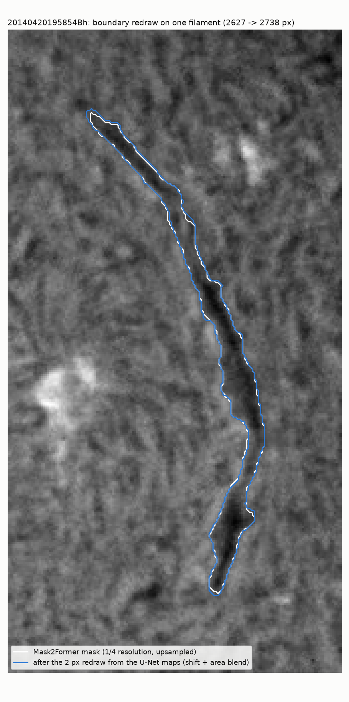

# kaggle_filament_2026
Code of our solution to the Kaggle competition filament-segmentation-2026: training, inference and the final submission.

## Solar filament instance segmentation

Solar filaments are dark, elongated clouds of cool plasma seen against the Sun's disk in H-alpha. The task
([filament-segmentation-2026](https://www.kaggle.com/competitions/filament-segmentation-2026)) is to outline every filament in 2048 x 2048
full-disk images as its own mask. Entries are scored by panoptic quality (PQ) against each annotator's drawing separately: a predicted mask
counts only if it overlaps that annotator's filament by more than half (IoU > 0.5).


The training set has 707 photos with 1,154 annotator records (one to three annotators per photo, 8,199 filaments). Annotators often
disagree, as above: 11 filaments for one, 7 for the other, and only some of them in common.

**Result: out-of-fold PQ 0.4783** on the 707 training photos (95% bootstrap interval 0.4696-0.4865; the five folds range from 0.4717 to
0.4861). Each photo is predicted by models that never saw it during training (see [Folds](#folds)). On the public leaderboard the final
submission (ref 58390515) shows 0.42; the previous one (ref 58304440, out-of-fold 0.4770) showed 0.41.


## Approach

```
 photos ──► Mask2Former, grayscale input (5 folds) ─────────► 8 views ──┐
        ──► Mask2Former, limb-corrected input (5 folds) ────► 8 views ──┴─► one fused 16-view candidate pool per photo
        ──► Mask R-CNN + 3 U-Nets (5 folds) ──► detector candidates, probability + spine maps ──┐
        ──► ROI detector + refiner (5 folds) ──► ROI candidates ────────────────────────────────┤
                                                                                                  ▼
   76 numbers per candidate ──► LightGBM scorer q (expected matched IoU) ──► on test, 5 fold models fused
   ──► exact non-overlapping selection ──► boundaries redrawn within 2 px from the U-Net maps ──► submission.csv
```

1. **Candidates.** Two Swin-S Mask2Former families, trained at native resolution on the 5 folds of `data/folds.json` (grouped by date).
   One reads the grayscale photo; the other reads the photo, its limb-darkening-corrected disk and a CLAHE copy. Each fold model predicts
   8 rotated / mirrored views, and the 16 views of a fold's two models are fused into one candidate pool.
2. **Evidence.** Independent models trained on the same folds check each candidate: a Mask R-CNN, three U-Nets (filament probability and
   centre-line maps), and a tiled ROI detector with a mask refiner.
3. **Learned scorer.** LightGBM predicts, for each candidate, its expected IoU with the annotators' filaments. It uses 76 numbers: shape,
   scores, image contrast, competing candidates and agreement with every evidence model. It is cross-fitted: every training photo is scored
   by a model that never saw its fold, on candidates from models that never saw it.
4. **Selection.** Among a photo's candidates, the set maximising the sum of (q - tau) with no two masks overlapping by more than 10 % of
   the smaller one, solved exactly (integer programming). On test, the 5 fold models' candidates are fused first.
5. **Full-resolution boundaries.** Mask2Former masks come out at 1/4 resolution. Each kept mask keeps its extent, and its boundary is redrawn
   within 2 px from the full-resolution U-Net probability maps, in two steps:
   * **Sub-pixel shift.** The probability map is moved 0.25 px towards the top of the photo, where the annotators' outlines sit on
     average.
   * **Area blend.** The new mask's area is the geometric mean of the Mask2Former area and the U-Net area (the U-Net blob above 0.5
     inside the 2 px band, ratio limited to 0.8-1.25); the band pixels with the highest probability are kept up to that area.

The models, epochs, scorer settings, selection threshold and redraw rule are chosen on out-of-fold PQ. The boundary redraw was revised
after the first submission, without retraining anything:

| Boundary of the kept masks (same selection, 707 out-of-fold photos) | PQ | Change |
|---|---|---|
| As emitted by Mask2Former | 0.4744 | |
| Previous rule: per-mask threshold on the U-Net map, 3 px (submission 58304440) | 0.4765 | +0.0021 (95% interval +0.0007 to +0.0035) |
| Same rule on the map shifted 0.25 px up, 2 px | 0.4774 | +0.0009 (+0.0001 to +0.0018) |
| **Final rule: shift + area blend, 2 px (submission 58390515)** | **0.4783** | +0.0009 (+0.0000 to +0.0018); **+0.0018 over the previous rule (+0.0008 to +0.0029)** |

The final rule is better than the previous one in each of the 5 folds. These numbers are from the second machine (see
[Hardware used](#hardware-used)), where the previous rule scores 0.4765 instead of 0.4770.




## Folds

Every model uses the same 5 folds, fixed in `data/folds.json` (142, 142, 141, 141 and 141 photos).

* **Grouped by day.** The 707 photos were taken on 656 days (UTC), up to 3 per day, mostly from different observatory sites; the date opens the
  file name (`YYYYMMDDhhmmss`, the letter before `h` is the site). Photos of the same day show the same filaments, so a day is never
  split between two folds. The folds were drawn once as a group k-fold over that date: no day is shared between folds, and every fold
  holds photos from at least 11 of the 12 years 2011-2022 and from all six sites.
* **Whole photos.** A fold holds photos, so all annotators of a photo are on the same side.
* **Fixed file.** The file is the reference: `src/data/split.py` reads it for every model (`FILAMENT_FOLDS_JSON`, `FILAMENT_VAL_FOLD`).
  Drawing a new group k-fold gives a different assignment, and then the shipped models would no longer be out of fold.
* **How they are used.** Each model is trained five times, once per fold, on the other four folds (565-566 photos), and predicts the fold
  it did not see. Every training photo therefore has an out-of-fold prediction. The scorer is cross-fitted on the same folds, and every
  choice (models, epochs, scorer settings, thresholds) is made on these out-of-fold predictions. On test, the five fold models are fused.

| Fold | 0 | 1 | 2 | 3 | 4 | All 707 photos |
|---|---|---|---|---|---|---|
| Out-of-fold PQ of the final pipeline | 0.4771 | 0.4861 | 0.4717 | 0.4809 | 0.4757 | 0.4783 |
| Previous submission (first server) | 0.4747 | 0.4870 | 0.4703 | 0.4800 | 0.4732 | 0.4770 |

The spread between folds (sd 0.0055) comes from the photos each fold holds, not from better or worse models: the five fold models are
trained the same way.

## Reproducing the result

`PIPELINE.ipynb` runs the whole pipeline, from the photos to `outputs/submission.csv`, with every step explained. Its last check compares
the result with the submitted file (Kaggle submission ref 58390515, kept in `reference/submission.csv`): by SHA-256, then mask by mask.

* **What to expect.** From the same U-Net maps, the selection and the redraw rebuild the submitted file **byte for byte**. The U-Net maps
  themselves are recomputed by the notebook, and they were not bit-identical between our two machines: rerun on the second machine, the
  previous pipeline changed 8 of its 1,247 test masks (the other 1,239 matched at a mean IoU of 0.999) and its out-of-fold PQ moved
  from 0.4770 to 0.4765. On another machine, expect the same kind of difference (a few masks) rather than the same hash.

* **Integrity.** The data, the 40 checkpoints and the shipped inference outputs are checked against `reference/CHECKSUMS.json`. A missing or
  changed model is listed with its training time, and retrained only after you confirm.
* **Training.** The training code was checked against the original runs: same losses at the first steps (to the digit for the ROI models,
  within GPU rounding noise for Mask2Former).
* **Time.** With the downloaded models, a run takes about 45 min on 4 x 12 GB GPUs (U-Net maps, then ~15 min of CPU for the scorer and
  redraw). Retraining all 40 models takes about 115 GPU-hours, about 28 h on 4 x 12 GB GPUs (details below).

### Hardware used

The models were trained, and the first submission (58304440) produced, on one rented cloud GPU server:

| | |
|---|---|
| GPUs | 4 x NVIDIA GeForce RTX 3080 Ti, 12 GB each (PCIe 4.0 x16), driver 595.99 |
| CPU | 2 x AMD EPYC 7543 (32 cores each); the container was limited to about 27 cores |
| Memory | 377 GB RAM, including a 41 GB RAM disk (`/dev/shm`) for the large intermediate files |
| Disk | 32 GB |
| Software | Ubuntu 24.04, Python 3.12.3, PyTorch 2.8.0 with CUDA 12.8 |

The final submission (58390515) was produced on a second machine, where the notebook rebuilds it byte for byte, from the same 40 downloaded models (inference, scorer,
selection and redraw only; nothing retrained): 2 x NVIDIA GeForce RTX 3080 (10 GB each), 4 CPU cores, 76 GB RAM, same PyTorch and CUDA
versions. There a run takes about 1 h 40 min, most of it in the CPU steps.

### Training time, and why it is long

Retraining all 40 models takes about 115 GPU-hours, about 28 h on this server. Inference adds about 1.5 h.

| Models | Runs | Time per run | GPU-hours | Wall time on the 4 GPUs |
|---|---|---|---|---|
| Mask2Former, 2 families x 5 folds | 10 | ~5.5 h | ~55 | ~16.5 h (one run per GPU, 3 rounds) |
| Mask R-CNN + 3 U-Nets, 5 folds | 20 | 1.2-2.7 h | ~35 | ~4.5 h (two runs per GPU) |
| ROI detector + refiner, 5 folds | 10 | 2-3 h | ~25 | ~5 h (up to 4 runs per GPU) |

* **Every model is trained 5 times**, once per fold. The scorer learns from out-of-fold predictions, so every training photo must be
  predicted by models that never saw it.
* **Mask2Former trains at native resolution**: 1024-pixel crops and whole 2048-pixel frames, 50 epochs of 231 optimiser steps (batch 8).
  On a 12 GB GPU the batch of 8 is accumulated one image at a time, and the backbone is recomputed in the backward pass (gradient
  checkpointing), so a step takes about 1.6 s. The held-out evaluations every 5 epochs add the rest.
* **12 GB limits sharing**: only one Mask2Former training fits on a GPU. A GPU with 40-80 GB of memory would avoid the accumulation and
  the recomputation, so it should be faster per step (not measured here).
* **A cheaper variant**: in the report's ablations, the ROI detector + refiner and the second Mask2Former family each add nothing
  measurable out of fold. Without them, retraining would take about 62 GPU-hours (about 15 h on 4 GPUs). Removing both at once was not
  measured.

### Setup

```bash
git clone git@github.com:Emualliug2705/kaggle_filament_2026.git && cd kaggle_filament_2026
python3.12 -m venv venv && . venv/bin/activate
pip install -r requirements.txt jupyterlab   # torch 2.8 for CUDA 12.8 comes from the PyTorch index set in the file
jupyter lab PIPELINE.ipynb          # run all cells; or headless: python run_headless.py
```

* **Kaggle.** Put your API token in `~/.kaggle/kaggle.json` and accept the competition rules. The photos and annotations are downloaded into
  `data/`.
* **Models.** `filament_models.tar` (7.4 GB: the trained models and the inference outputs) is downloaded from Google Drive (the link is in
  `reference/DOWNLOADS.json`). You can also place it in `downloads/`. Its SHA-256 is checked before extraction.
* **Hardware.** Linux, NVIDIA GPUs with 12 GB or more, a driver supporting CUDA 12.8, and ~35 GB free for `work/scratch`. Keep the
  repository on a normal disk, not a `noexec` RAM disk. To move a folder, set `FILAMENT_DATA`, `FILAMENT_MODELS`, `FILAMENT_WORK`,
  `FILAMENT_SCRATCH`, `FILAMENT_OUTPUTS` or `FILAMENT_DOWNLOADS`.

## Layout

```
src/
  paths.py          every folder the pipeline uses (environment overrides)
  data/             folds and splits, photo utilities
  models/           mask2former/ (model, data, training loop, evaluation), maskrcnn.py, unet.py, roi/ (detector + refiner)
  training/         launchers and trainers: mask2former.py, evidence_models.py, train_unet.py, train_maskrcnn.py, train_roi.py
  inference/        Mask2Former caches and views, two-family pools, ROI banks, view fusion
  scorer/           features + LightGBM + selection (selector.py), exact selection (select.py), boundary redraw
  evaluation/       out-of-fold matching and PQ, validation sweeps, comparison of two submission files
  utils/            masks, events
configs/            model and data settings
data/folds.json     the 5 folds (photos and annotations are downloaded)
reference/          checksums, download sources, the submitted file and its SHA-256, epoch table, figures
report/             the competition report (LaTeX, first draft)
models/  work/  outputs/  downloads/     created by the notebook (git-ignored)
```

## Licence

AGPL-3.0 (`LICENSE`). Parts of `src/` are adapted from open-source public kaggle submission to this challenge; see `THIRD_PARTY_NOTICES.md`.
