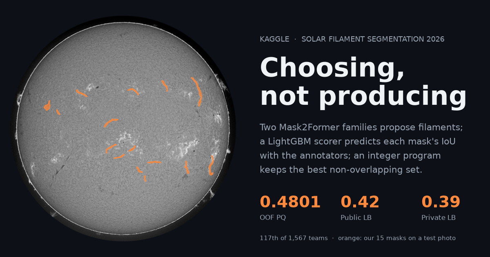
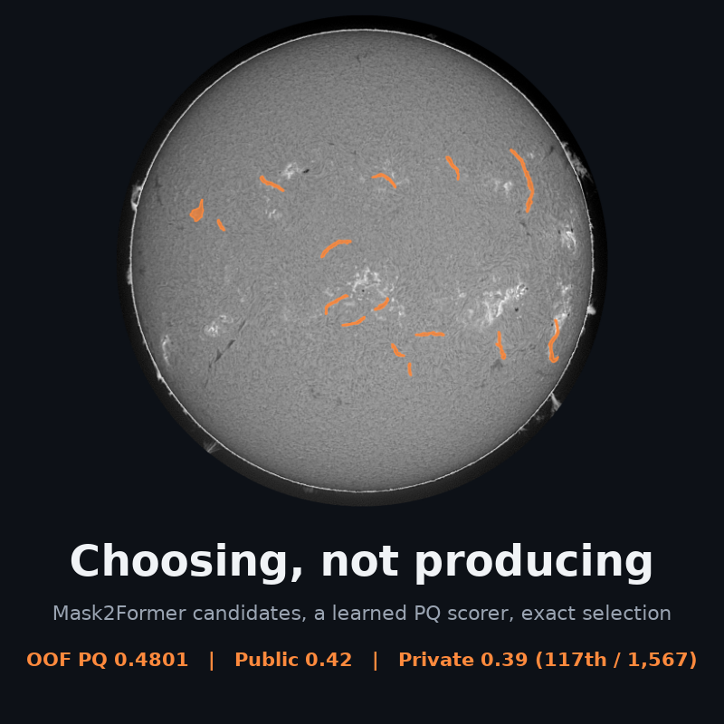

# Kaggle writeup

Everything needed to fill in the competition's writeup form, one file per field.

| Field | File | Value |
|---|---|---|
| **Title** | [`title.txt`](title.txt) | 117th Place Solution: Choosing, Not Producing |
| **Subtitle** | [`subtitle.txt`](subtitle.txt) | Mask2Former candidates, a LightGBM scorer trained on PQ's own question, and an exact integer-program selection (OOF 0.4801, private 0.39) |
| **Writeup URL** * | [`writeup_url.txt`](writeup_url.txt) | `117th-place-solution-choosing-not-producing` |
| **Thumbnail / card image** | [`thumbnail.png`](thumbnail.png) (1200 x 630), [`thumbnail_square.png`](thumbnail_square.png) (800 x 800) | below |
| **Content** | [`content.md`](content.md) | the writeup body (Markdown), ~1,000 words |

 

## Notes

* **Writeup URL.** The slug of the writeup's address, which becomes
  `https://www.kaggle.com/competitions/filament-segmentation-2026/writeups/117th-place-solution-choosing-not-producing`. If the form
  instead asks for a link to the solution, use the repository: `https://github.com/Emualliug2705/kaggle_filament_2026`.
* **Thumbnail.** Use `thumbnail.png`; `thumbnail_square.png` is for a square crop. The orange masks are our 15 submitted filaments on
  test photo `20140420195854Bh` (from `reference/submission.csv`). `make_thumbnail.py` regenerates both cards (it needs the competition
  photos in `data/`, as the notebook downloads them).
* **Content.** Paste `content.md` into the editor. Its images and links point to this repository on GitHub (`main` branch), so they
  display only while the repository is public.
* **Numbers.** Every figure in the writeup comes from this repository: out-of-fold PQ from `PIPELINE.ipynb` and the report, the
  leaderboard scores and rank from the Kaggle API (submission 58424919; public rank 36, private rank 10 of 1,708).
