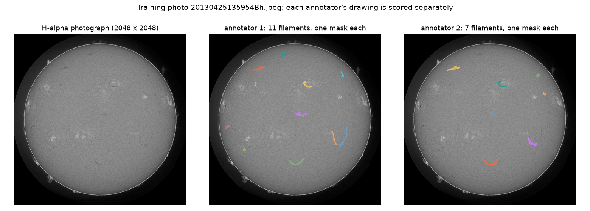
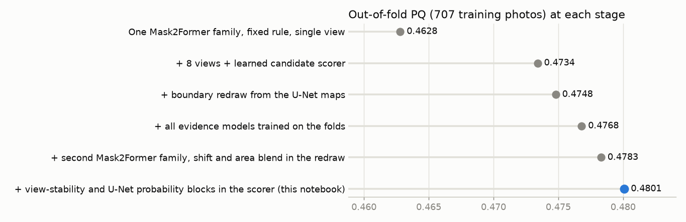
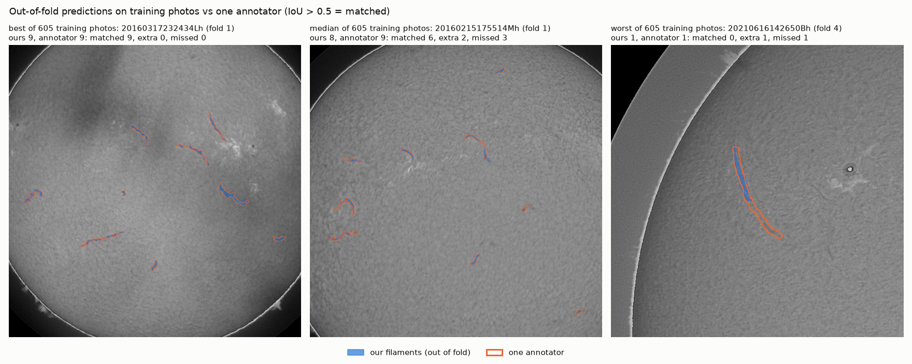

Thank you to the organisers for a carefully annotated dataset and an interesting metric, and to everyone who shared ideas in the
discussions. This was a long, meticulous competition for us, and most of what we learned is about *choosing* masks rather than
*producing* them. Everything below is in our repository: code, report, and a notebook that rebuilds the submitted file byte for byte.

**Code:** https://github.com/Emualliug2705/kaggle_filament_2026 · **Report (PDF):** https://github.com/Emualliug2705/kaggle_filament_2026/blob/main/report/main.pdf

## TL;DR

- **Result.** Out-of-fold PQ **0.4801** on the 707 training photos (95% bootstrap interval 0.4714–0.4882), public LB **0.42**
  (rank 36), private LB **0.39** (rank 10 of 1,708).
- **Observation.** Our candidate pool already contains a match (IoU > 0.5) for ~90% of the annotated filaments. Choosing perfectly
  among the candidates we already had would score ~0.58 out of fold, against 0.48 for our final selection: the bottleneck is
  selection, not candidate generation.
- **Answer.** A LightGBM scorer predicts, for each candidate, the IoU it will reach with the annotators' filaments; an exact integer
  program keeps the best non-overlapping set; each kept boundary is redrawn at full resolution from U-Net maps.
- **Humility.** Two annotators of the same photo agree at PQ 0.340. A large share of what remains is annotator disagreement that no
  model can learn.

## Pipeline

1. **Candidates.** Two Swin-S Mask2Former families trained at native resolution (1024-px crops and whole 2048-px frames): one reads
   the grayscale photo, the other the photo, its limb-darkening-corrected disk and a CLAHE copy. Each fold model predicts the 8
   flips/rotations; the 16 views of a fold's two models are fused by consensus (IoU link 0.5, pixel vote 0.5, score = mean member score
   × (0.5 + 0.5 × members / 16)).
2. **Evidence.** Independent models trained on the same folds check every candidate: a Mask R-CNN, three U-Nets predicting a
   filament-probability map and a centre-line ("spine") map, and a tiled detector with a mask refiner.
3. **Scorer.** For each candidate the target is the mean, over the photo's annotators, of its IoU with the filament it overlaps most,
   counted as 0 below 0.5: exactly what the candidate adds to the PQ numerator per annotator. LightGBM regression on 129 numbers per
   candidate (shape, scores, contrast, competing candidates, agreement with each evidence model, the U-Net maps inside and around the
   mask, and how stable the candidate's outline is across the 16 raw views), averaged over 10 seeds, cross-fitted on 5 folds grouped by
   day (photos of the same day show the same filaments). Out-of-fold correlation with the target: 0.780 (the fused score alone: 0.702).
4. **Selection.** A kept mask always adds ½ to the PQ denominator per annotator (a TP replaces an FN, or it is an FP), so it pays only
   if its expected matched IoU exceeds PQ/2. We keep the set maximising Σ(q − τ) with no two masks overlapping by more than 10% of the
   smaller one, τ = 0.25 chosen out of fold (≈ PQ/2, as theory says). We solve it exactly (a small integer program per connected
   component of the conflict graph) rather than with NMS: if a filament is proposed both whole (A) and as two halves (B, C), greedy
   keeps A whenever it scores highest, while the exact solution keeps B + C when together they are worth more.
5. **Boundaries.** Mask2Former masks come out at 1/4 resolution. Each kept mask keeps its extent; its boundary is redrawn within 2 px
   from the mean of two U-Nets' probability maps, shifted 0.25 px up (where annotators' outlines sit on average), with the new area the
   geometric mean of the Mask2Former and U-Net areas.
6. **Test.** The 5 fold models' candidates are fused the same way as the views (a candidate proposed by few fold models is marked
   down), then selected with the out-of-fold τ.

## Out-of-fold progression (707 photos)

| Step | OOF PQ |
|---|---|
| One Mask2Former family, single view, fixed score threshold | 0.4629 |
| Two families, 16-view pool, fixed threshold | 0.4693 |
| + learned scorer and exact selection (τ chosen on 4 folds) | 0.4739 |
| + boundary redraw from the U-Net maps | 0.4783 |
| + view-stability and U-Net probability features, 10 seeds | **0.4801** |

## What did not work (out of fold)

- **More candidates.** Adding the Mask R-CNN and tiled-detector instances to the pool raises the perfect-selection ceiling from 0.58
  to 0.62, but the scorer cannot tell which of the new ones annotators drew: no gain. The filaments our pool misses are mostly the ones
  annotators disagree on.
- **Metadata.** Selection thresholds per year (solar-cycle phase), observatory site or hour: gains on all folds that vanish when the
  threshold is chosen on 4 folds and applied to the 5th. The scorer is already calibrated across the solar cycle.
- **Neighbouring days.** We carried the training annotations of photos taken within a few days onto each candidate by differential
  solar rotation. The signal is real (it correlates with the target), but the scorer already knows it from the image.
- **Shape.** Crescent-shape features, merging or splitting masks, morphological smoothing, a per-mask learned width, and a small U-Net
  trained to redraw our masks the way annotators draw them (−0.002): the remaining shape error looks like annotator-to-annotator
  variation.
- **Stacking** a second-stage scorer on the first one's predictions: worse.
- **A lesson on noise.** Changing only the scorer's random seeds moved OOF PQ by ~0.0005 (and the nested estimate by ~0.001). We ended
  up judging every change with 10 seeds, averaged over a range of τ, and replicated on a second seed set; several early "+0.002"
  results did not survive that.

## Leaderboard

OOF 0.48 → public 0.42 → private 0.39. Our two last submissions (OOF 0.4783 and 0.4801) both scored public 0.42 and private 0.39; one
LB probe with a lower threshold (τ = 0.20) dropped to public 0.41 (private 0.39, like the others), in the direction out-of-fold PQ
predicted, so we kept trusting the out-of-fold choices.

## Reproducibility

`PIPELINE.ipynb` runs everything from the raw photos to the CSV. With the 40 trained models downloaded (7.4 GB) it rebuilds the
submitted file byte for byte; we checked this from a fresh clone, a fresh environment and fresh downloads (about 1 h 45 on
2 × RTX 3080). Retraining all 40 models takes ~115 GPU-hours. The report details every step and ablation.

Thanks for reading, and congratulations to the winners!
